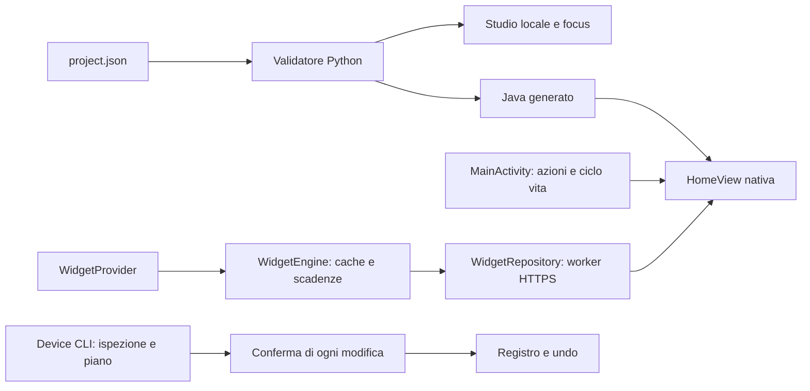

# Architettura e confini

La CLI dispositivo non fa parte dell'APK; nessuna ottimizzazione del sistema avviene perché si compila o si apre la Home. Lo studio non chiama la CLI dispositivo e non riceve snapshot privati.

## Thread e memoria

- Main thread: view, focus, callback Android e snapshot immutabili dei widget.
- Worker widget: caricamento cache, parser e HTTPS; scadenze effettive, niente polling fisso. Zero timer widget se tutti sono disabilitati; timer cancellato quando Home è nascosta.
- Worker stato: enumerazione ingressi, risoluzione Intent e stato rete.
- Worker immagini: asset locali dopo la creazione della UI, con campionamento e budget totale decodificato di 4 MiB. In carenza di spazio compare l'etichetta; il worker termina dopo la coda iniziale.
- Catalogo app: caricamento asincrono, pagina di otto elementi, cache icone da 1 MiB. La UI si conserva quando i dati non cambiano; gli aggiornamenti arrivati mentre è nascosta restano da renderizzare.
- Contenuto remoto: titolo limitato a 100 caratteri, massimo cinque righe da 240 caratteri, senza controlli o multilinea; i dati eccedenti sono rifiutati prima della UI.
- Testo: fitting binario e cache LRU limitata a 192 risultati, ellissi rispettosa dei code point Unicode. Citazioni e geometrie vettoriali si preparano fuori dal percorso di disegno ripetuto.

I budget coprono bitmap/caches specifiche, non la memoria totale del processo. Android, font, cache grafiche e provider consumano altre risorse. Servono misure PSS e frame-time sul dispositivo per quantificare i benefici.

## File e dipendenze

La build prepara gli asset selezionati: font/licenza richiesti e soltanto PNG richiamati dai riquadri. Non impacchetta l'intera cartella assets. I PNG sono limitati a 4 MiB/file e 8192 pixel/lato; la selezione totale ha un limite di 12 MiB. Questo non sostituisce una verifica di licenza o del contenuto.

Le dipendenze di test non vengono incorporate nell'app. Non serve un framework WebView o Compose per il launcher. Il codice usa Java 8 e l'API framework Android; le nuove API richiedono guardie di versione anche se la compilazione con SDK 34 passa.

## Limiti espliciti

Rimane da verificare fisicamente il comportamento su più firmware: avvio e standby, tasto Home, misure di jank, correttezza delle fonti nel tempo e route AV/HDMI. Il servizio opzionale di Accessibilità si ferma se setup/provisioning non sono esplicitamente completi; non forza la scelta disabilitando launcher. Un firmware senza quei segnali può richiedere la Home dalle normali impostazioni.
